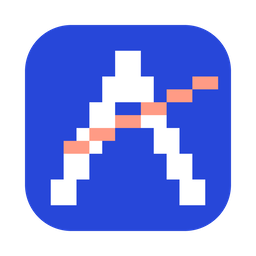
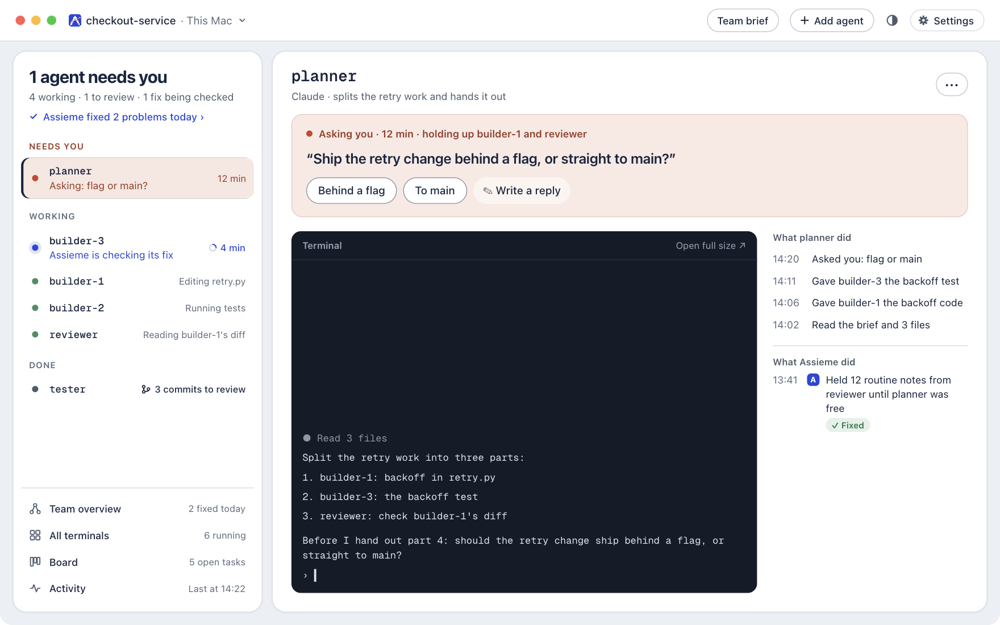
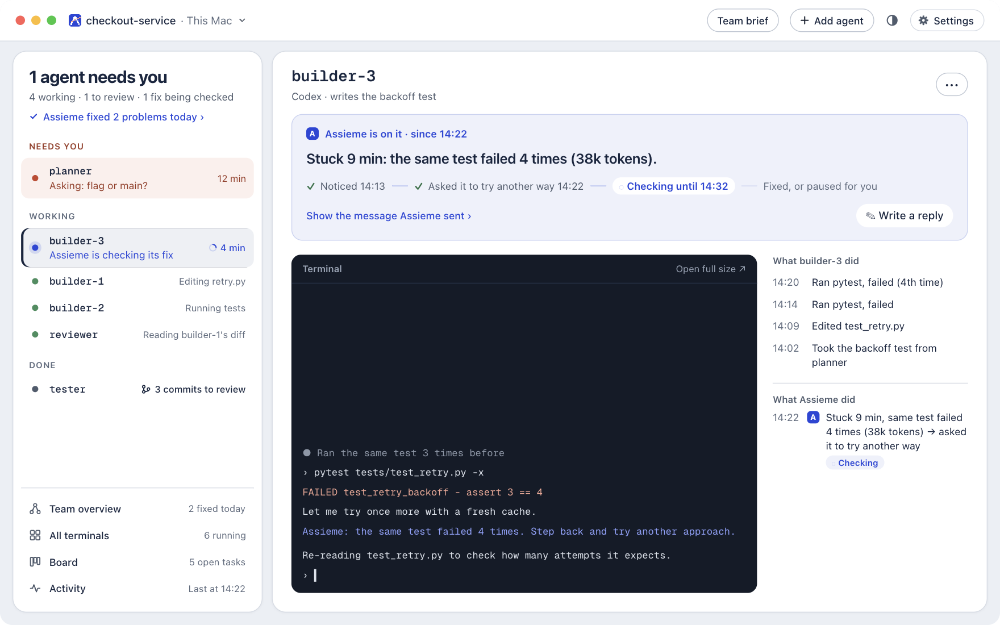
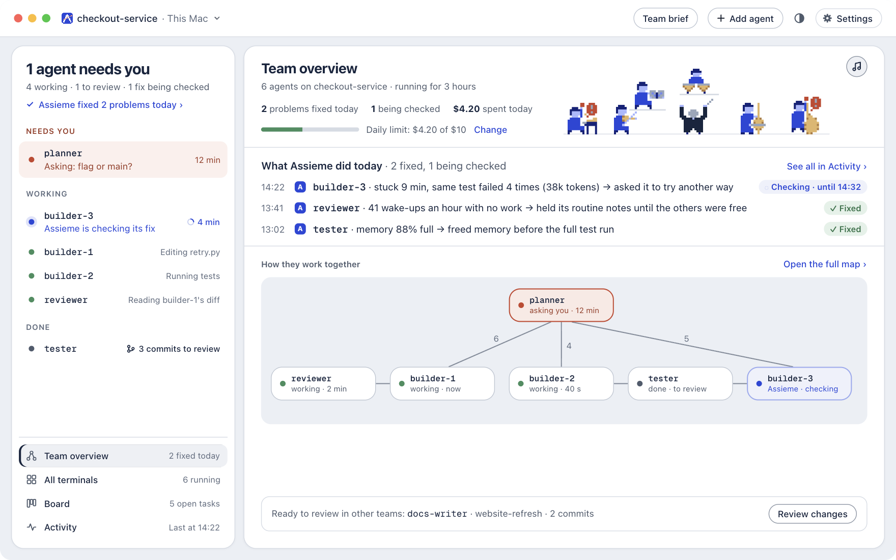
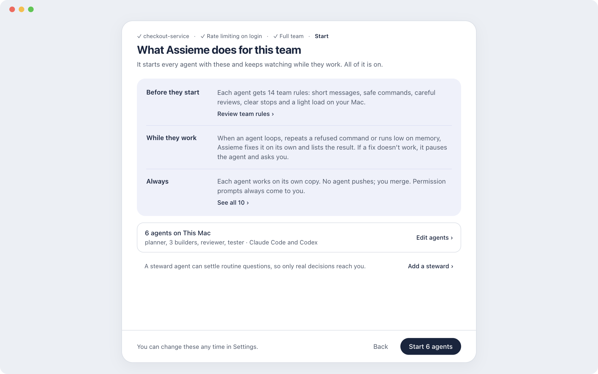

<p align="center">
  
</p>

<h1 align="center">Assieme</h1>

<p align="center">
  <em>Your coding agents, playing together. You conduct.</em>
</p>

<p align="center">
  
  
  
  
  
</p>

<p align="center">
  
</p>

Assieme ("together", in Italian) runs a team of coding agents on your Mac: Claude Code, Codex, Antigravity, Gemini
CLI, OpenCode and Cursor. Each agent works on its own branch, in its own live terminal. One window shows who is
working, who has stopped and who needs you. When an agent gets stuck, loops or runs low on memory, Assieme fixes it on
its own and lists what it did. Questions, merges and money stay yours.

<p align="center">
  
</p>

---

## Why Assieme

- **One window for the whole team.** The agents on the left, grouped by what they need from you. An agent with a
  question goes to the top, with how long it has waited and who it is holding up; answer with one click.
- **It fixes problems on its own.** A stuck agent, a repeated refused command, memory filling up: Assieme acts, checks
  that the fix worked, and pauses the agent and asks you if it did not.
- **You decide what matters.** Agents never push. You review each branch, then merge, with Undo.
- **Fast and light, because it runs on Rust.** Assieme is one Rust program that runs the terminals, watches the agents
  and answers the app. There is no Python or Node runtime to install. It idles at about 35 MB of memory, its agent
  hooks start in under 5 ms, and the app is a 30 MB download.

## Assieme fixes it, then tells you

<p align="center">
  
</p>

Each fix shows what Assieme noticed, what it did and when it will check the result. A fix that does not work pauses
the agent and asks you. Every action is in Activity, with Undo where it applies.

## The team at a glance

<p align="center">
  
</p>

What Assieme did today, what the team has spent against its daily limit, and a map of who works with whom.

## Every terminal, live

<p align="center">
  
</p>

Real terminals that keep running when the window is closed. Answer from the pane, or open one full size to type.

## Review, then merge

<p align="center">
  
</p>

The diff, the test results, the conflict check and the reviewer's notes, on one screen. Ask for changes, open a pull
request, or merge. Assieme refuses a merge that would lose work, and Undo puts the branch back.

## A new team, ready to work

<p align="center">
  
</p>

Choose a project, a task and a team, from one agent to a planner with builders, a reviewer and a tester. Before you
start, Assieme shows what it does for the team: rules for every agent, fixes while they work, a branch per agent and no
pushes.

## Also in the app

- **Daily limits** per team or per agent: at the limit, Assieme pauses and asks you, or just tells you.
- **Bring your team over** from another tool, with its agents, folders and branches.
- **Remote machines:** run agents on a Linux box or another Mac over SSH, shown in the same window.
- **Previews** of a web app an agent is building, stopped when its work is merged.
- **Your assistant helps, you stay in charge.** Connect Assieme to Claude Code, Codex or the Claude app, then ask
  "What needs me?" from your phone. Every change asks you first.

## Install

**Download** the latest `.dmg` from [Releases](https://github.com/MoatCast/assieme/releases/latest), open it and drag
Assieme to Applications. It is signed and notarised by Apple, and updates itself.

You need an Apple silicon Mac and at least one coding agent, such as Claude Code or Codex. First run finds the agents
you already use and sets up the rest.

<details>
<summary>Build from source</summary>

You need Node, Rust, [just](https://github.com/casey/just), [Zig](https://ziglang.org) 0.16 (for the terminal
library) and `cargo install --locked cargo-zigbuild` (for the Linux builds remote machines use).

```bash
git clone --recurse-submodules https://github.com/MoatCast/assieme.git
cd assieme/runtime && just check     # the runtime and the brain, with their tests
cd ../app && npm install
sh scripts/bundle.sh                 # builds the runtime into the app
npx tauri build --bundles app
open src-tauri/target/release/bundle/macos/Assieme.app
```

Set `ZIG` to your Zig binary if it is not on your `PATH`.

</details>

<details>
<summary>Command line</summary>

For scripts and power users: install it from Settings › General › Command line tools in the app.

```bash
assieme status                  # one line per agent: working, stuck, waiting on you
assieme team status             # the agents of every team
assieme team start <preset> --task "Add retries to the payment client"
assieme team stop <team>
```

</details>

## Safe by default

Assieme never kills an agent without asking, never widens an agent's permissions and never answers a permission
prompt for you. Pushing is blocked by default; an agent's work stays on its own branch until you merge it.
Assieme runs on your Mac with no telemetry, and talks only to your agents, your git remote and any assistant you
connect.

## Licence

Apache-2.0. See [LICENSE](LICENSE). The runtime in `runtime/` is a fork of
[herdr-core](https://github.com/herdrdev/herdr-core), also Apache-2.0. Bug reports and ideas are welcome; see
[CONTRIBUTING.md](CONTRIBUTING.md) and [SECURITY.md](SECURITY.md).
