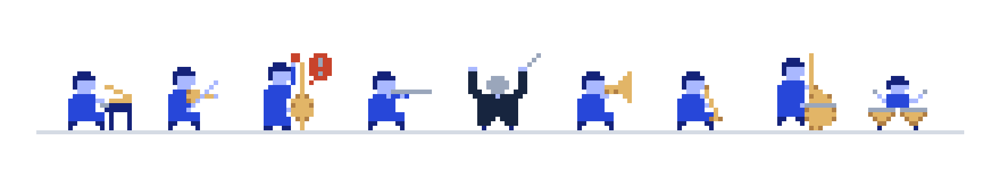
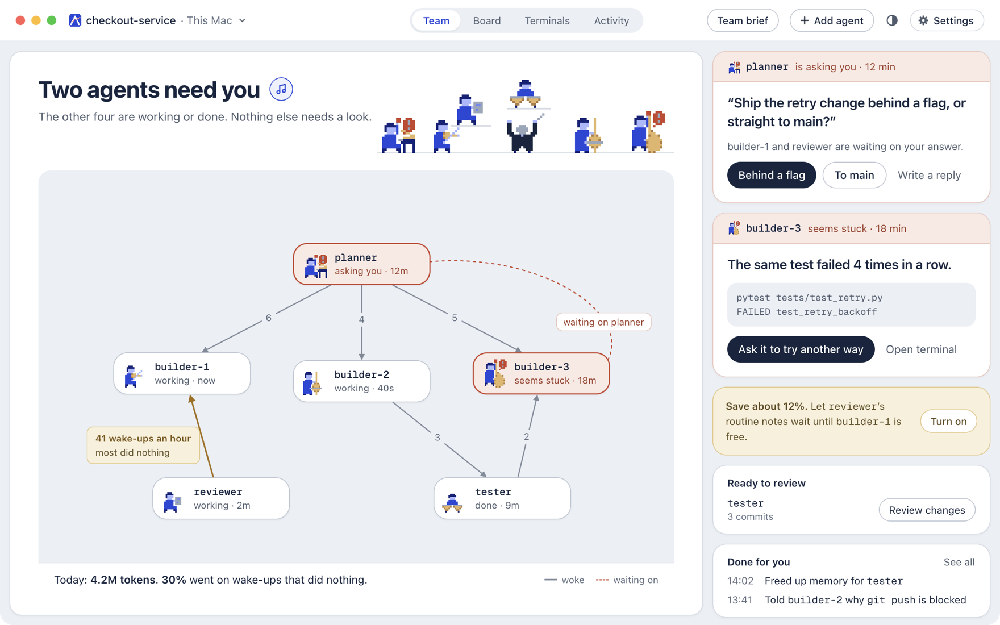
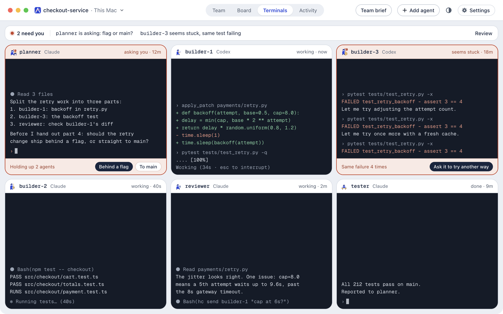
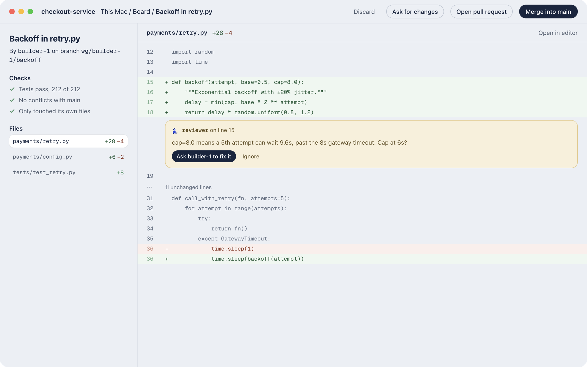
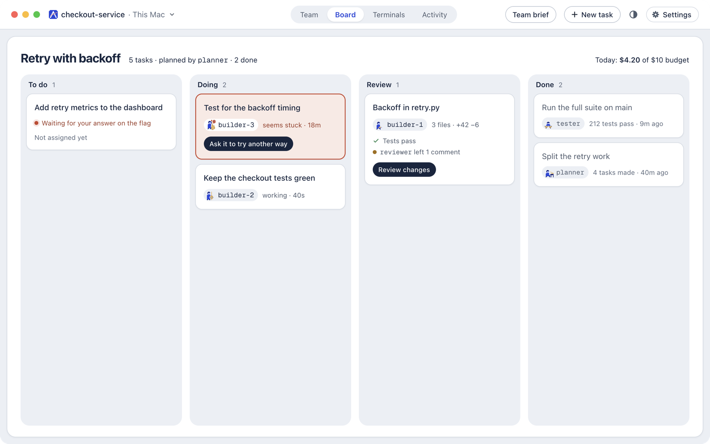
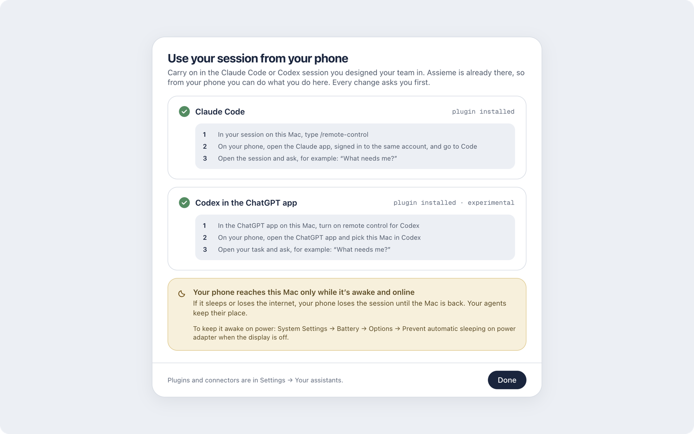

<p align="center">
  
</p>

<h1 align="center">Assieme</h1>

<p align="center">
  <em>Your coding agents, playing together. You conduct.</em>
</p>

<p align="center">
  
  
  
  
</p>

<p align="center">
  
</p>

Assieme ("together", in Italian) runs a team of Claude Code and Codex agents on your Mac. Each agent plays its own part
on its own branch. Assieme shows you who is playing, who has stopped and who needs you, and fixes the problem with
your say-so.

---

## The team, on stage

<p align="center">
  
</p>

Every agent is a musician, and its role is its instrument. A raised hand means it needs you. The map below shows who
wakes whom, and the cards on the right hold each question with its answers and each problem with its fix.

## Every terminal, live

<p align="center">
  
</p>

Real terminals that keep running when the window is closed. Answer a question from the pane, or open one full size to
type.

## Review, then merge

<p align="center">
  
</p>

Every agent that edits works on its own branch. One screen holds the diff, the test results, the conflict check and
the reviewer's notes, with Ask for changes, Open pull request, Merge and Undo.

## The plan, as it moves

<p align="center">
  
</p>

The planner's split becomes cards that move from to do to done, reported by the agents themselves.

## From your phone

<p align="center">
  
</p>

Install Assieme in Claude Code, Codex or the Claude app from Settings. Then ask, from your phone, "What needs me?",
answer an agent, review its work or start a team. Every change asks you first.

## What makes it unique

Other tools let you start agents and watch them. Assieme also notices the problem, explains it and offers the fix.

- **It says why a team has stopped,** following who waits on whom down to the cause:
  `lead waits on you (asked 10 min ago)`.
- **Every alert comes with its fix:** a stuck agent, a refused command, memory filling up. One button, or automatic
  once you trust it, and logged with Undo.
- **It shows what agents cost each other,** tracing the wake-ups that re-read a whole context and did no work.
- **Agents report for themselves,** saying when they are stuck or need a decision.
- **A new team starts tuned:** a branch per builder, read-only reviewers, no `git push`, and practices learned from real
  teams.
- **Your assistant helps, you stay in charge.** Claude Code, Codex or the Claude app can act on your teams; every change
  asks you first.

## Install

**Download** the latest `.dmg` from [Releases](https://github.com/MoatCast/assieme/releases/latest), open it and drag
Assieme to Applications. It is signed and notarised by Apple, and updates itself.

You need an Apple silicon Mac and Claude Code or Codex. First run finds the agents you already use and sets up the
rest.

<details>
<summary>Build from source</summary>

You need [uv](https://docs.astral.sh/uv/), Node and Rust.

```bash
git clone https://github.com/MoatCast/assieme.git
cd assieme/app
npm install
sh scripts/bundle.sh
npx tauri build --bundles app
open src-tauri/target/release/bundle/macos/Assieme.app
```

</details>

<details>
<summary>Command line</summary>

For scripts and power users: `uv tool install .` from this folder (Python 3.11+).

```bash
assieme                         # live view: what needs you, alerts, one-key fixes
assieme status [--watch]        # one line per agent, alerts first
assieme report --hours 24       # who woke whom, what it cost, what was refused
assieme team start <preset> --task "Add retries to the payment client"
```

</details>

## Safe by default

It never kills an agent without asking, never widens permission rules and never answers a permission prompt for you.
An agent's work stays on its own branch until you merge it. Assieme runs on your Mac with no telemetry, and talks only
to your agents, your git remote and any assistant you connect.

## Licence

Apache-2.0. See [LICENSE](LICENSE). The runtime in `runtime/` is a fork of
[herdr-core](https://github.com/herdrdev/herdr-core), also Apache-2.0. Bug reports and ideas are welcome; see
[CONTRIBUTING.md](CONTRIBUTING.md) and [SECURITY.md](SECURITY.md).
